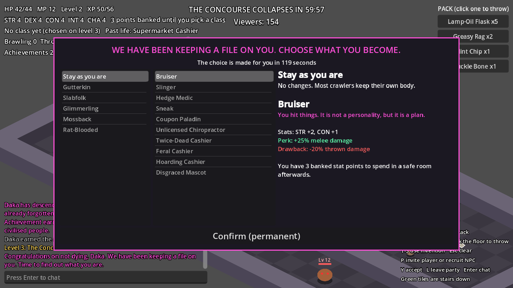

# DCC-MUD

A multiplayer pixel-art dungeon game-show crawler (working title: **Crawl Show**).
Players descend through levels that collapse on a timer while a sardonic system
narrator and a simulated audience watch. The world, names and narrator are original.



## What works now

- **Multiplayer**: a dedicated server runs all the rules. Each player has their
  own isometric view of a shared, persistent dungeon. Players who meet can form a
  party (shared XP, party health list) and chat.
- **Your own character**: pick a name, a past life (which grants starting skills)
  and one of three starting locations. There is an empty pet slot for later.
- **NPC companions**: one waits at each starting location. A solo player can
  recruit them; they follow and fight, and step aside once you team up with a
  real player.
- **Three levels with stairs**: each has its own collapse timer and tougher
  monsters than the last.
- **The level 3 choice**: for two levels you have no class and your level-up
  stat points are banked. The game keeps a hidden dossier of what you do. On
  arriving at level 3 you are offered a personal list of races and classes built
  from it: classics, classes from your past life, classes from how you played,
  generated combinations of the two, and a joke class if you earned one. Each
  has a perk and a real drawback. The choice is timed and permanent, and unlocks
  spending stat points in safe rooms.
- **Game show layer**: viewer count, achievements with mocking text, tiered loot
  boxes that only open in safe rooms, narrator lines.
- **Basics**: five stats, melee, thrown items with tag-based effects, monsters
  with levels, skills that grow with use, safe rooms, death and respawn.
- **Crafting as a class perk**: the Dumpster Alchemist class can combine up to
  three items and invent named concoctions whose traits come from how they were
  discovered (`engine/invention.gd`).

All art is placeholder shapes. See [docs/sprite-spec.md](docs/sprite-spec.md) for
the sprite sizes real art should follow.

## Running it

Install [Godot 4.3 or newer](https://godotengine.org/download) (standard build, free).

- **Try it alone**: open the project in Godot, press Play, click **Host and play**.
- **Play together**: one machine runs the server, everyone else clicks
  **Join server** and types its address.

```
# dedicated server (default port 24555, UDP)
godot --headless --path . -- --server

# optional: --port=24555 --seed=42
```

### Controls

| Key | Action |
| --- | --- |
| WASD or arrows | Move |
| Space, or click with nothing selected | Melee attack |
| Click an item in the pack, then click the floor | Throw it (crafting classes can select up to 3) |
| 1-5 | Use an invention at the mouse position |
| P / Y / L | Invite nearest player or recruit a nearby NPC / accept invite / leave party |
| Enter | Chat |

Try this: recruit the NPC in your starting room with P, fight your way to the
green stairs tile on each level, and see which classes you are offered on level 3.
Play differently (punch everything, throw everything, hide, die a lot) and the
list changes.

## Layout

| Path | What it is |
| --- | --- |
| `data/` | All content as JSON: items and tags, tag rules, context rules, monsters, achievements, boxes, narrator lines, the level map |
| `engine/class_offers.gd` | Builds each player's race and class offers from their dossier |
| `engine/invention.gd` | The crafting class's invention engine (pure functions) |
| `server/world.gd` | The authoritative game simulation |
| `server/net.gd` | Networking: validates client requests, sends snapshots and events |
| `client/game_client.gd` | Isometric renderer and HUD |
| `client/bot.gd` | Scripted player for automated multiplayer tests |
| `tests/` | Rules tests and a two-player smoke test |

## Tests

```
godot --headless --path . --import          # once, builds the class cache
godot --headless --path . -s tests/run_tests.gd
GODOT=godot tests/multiplayer_smoke.sh      # server + three bot players
```

## Adding content

No code changes are needed for any of these:

- A class: a row in `data/classes.json` with offer conditions, stat changes,
  modifiers, a perk and a drawback.
- A past life, race, companion, achievement, loot box, monster or item: a row in
  the matching file in `data/`.
- A level: a map in `data/floors.json`.

## Design files

`design/` holds the rules and content in plain words and tables, split by topic. Start at `design/README.md`.

## Adding art

Put pictures in the folders inside `art_inbox`, then double-click `make_sprites.bat` (needs Aseprite). See
`design/07-art.md`.
